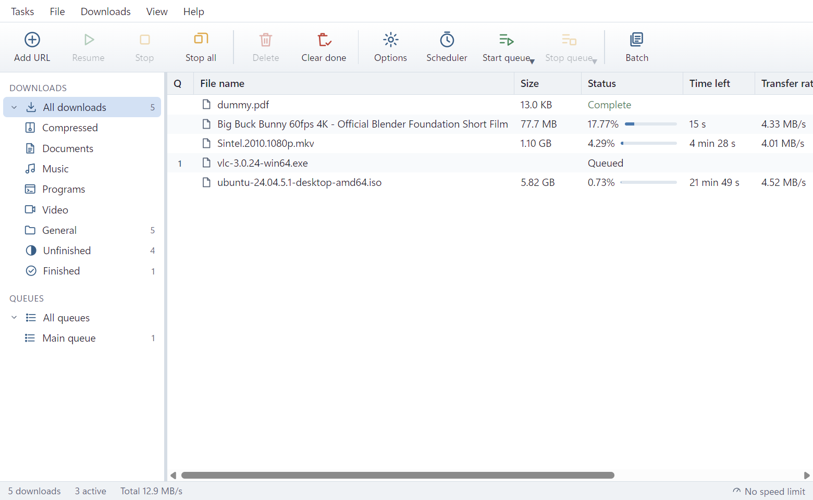
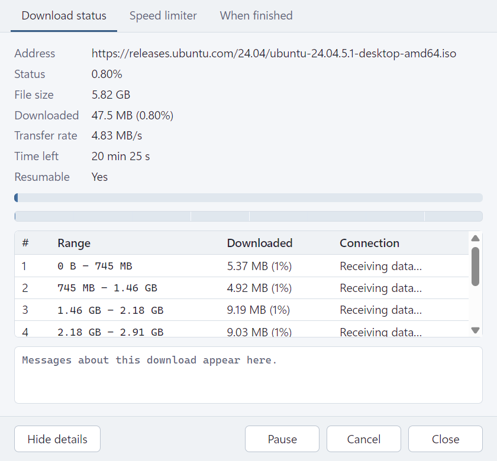
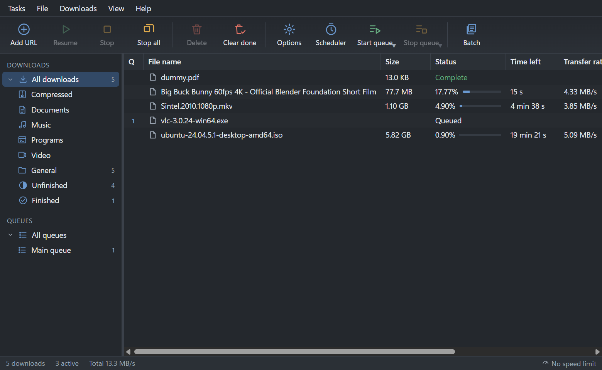
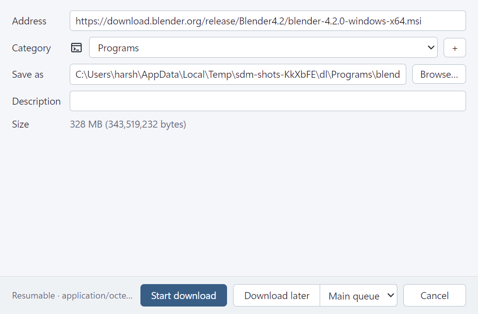
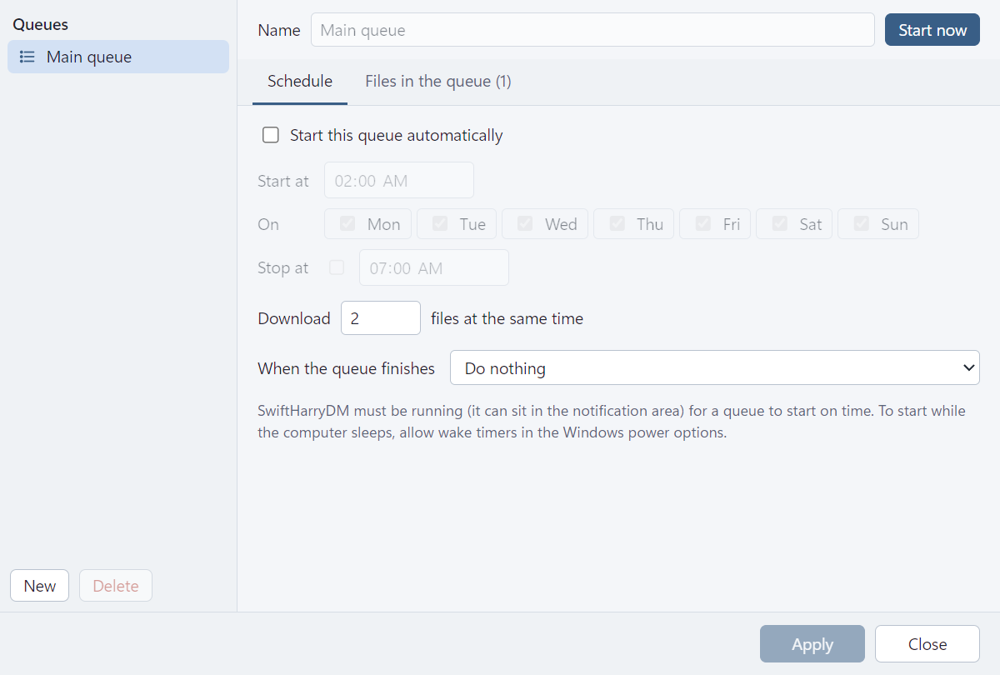

<div align="center">


# SwiftHarryDM

**A fast, lightweight download manager for Windows.**<br>
Splits every download across many connections, survives crashes and restarts, saves video
and audio from web pages, and takes over downloads from your browser.

[](https://github.com/theharshchaudhary/SwiftHarryDM/actions/workflows/ci.yml)


[](LICENSE.txt)

[**Download**](https://github.com/theharshchaudhary/SwiftHarryDM/releases/latest) ·
[Features](#features) ·
[Screenshots](#screenshots) ·
[Browser extension](#browser-extension) ·
[Build from source](#build-from-source)



</div>

## Highlights

<table>
<tr>
<td width="33%" valign="top">

### ⚡ Fast
Up to 32 connections per file with dynamic splitting: when a connection finishes, it takes
over half of the largest part still left. 436 MB/s on a local test with 8 connections.

</td>
<td width="33%" valign="top">

### 🛡️ Hard to break
Resumes after pauses, network drops, restarts and crashes. Data is on disk before progress is
recorded. In 25 runs with 153 hard kills of the downloader, every file came out exact.

</td>
<td width="33%" valign="top">

### 🪶 Light
About a 7 MB installer, FFmpeg included. About 25 MB of memory while downloading a 1 GB file.
No administrator rights needed.

</td>
</tr>
<tr>
<td valign="top">

### 🎬 Video and audio
Save from YouTube and many other sites in 4K to 360p, as MP4, MKV, MP3 or M4A. On other sites,
the extension catches the HLS, DASH or media streams the page's player loads.

</td>
<td valign="top">

### 🌐 Browser take-over
The Chrome, Edge and Brave extension hands downloads to the app by file type and size, and
connects by itself. Hold <kbd>Alt</kbd> to leave a download to the browser.

</td>
<td valign="top">

### 🔄 One-click updates
A bar offers **Update now**. The update is downloaded, its signature is checked, it installs,
and the app restarts with your downloads carrying on.

</td>
</tr>
</table>

## Screenshots

<table>
<tr>
<td width="50%"><br><sub><b>Progress</b>: every connection's range and state</sub></td>
<td width="50%"><br><sub><b>Dark mode</b>: follows Windows, or set it yourself</sub></td>
</tr>
<tr>
<td><br><sub><b>Before downloading</b>: size, category and folder are filled in for you</sub></td>
<td><br><sub><b>Scheduler</b>: queues with start and stop times</sub></td>
</tr>
</table>

## Features

<details open>
<summary><b>Downloads</b></summary>

- Up to 32 connections per file, with dynamic splitting of the largest remaining part.
- Resume after pauses, network drops, app restarts and crashes. Before resuming, the file on
  the server is checked to make sure it hasn't changed.
- Checks that connections received the same file where their parts meet. If mirrors serve
  different files, this is detected and the download continues on one connection.
- Speed limiter, overall or per download, that you can change while downloading. The overall
  limit is shared fairly between downloads.
- Download quota ("no more than X MB every Y hours") and per-server connection limits.
- Refresh an expired download address without losing the part already downloaded.
- Categories with their own folders, duplicate-link handling, and an antivirus scan after
  each download.

</details>

<details open>
<summary><b>Video and audio</b></summary>

- Best quality, 4K to 360p, MP4, MKV, MP3 or M4A, or an exact format from the list.
- Streams (HLS, DASH, media files) the page's player loads are found on sites the video finder
  doesn't know. The toolbar badge shows how many were found.
- FFmpeg ships with the app: a small LGPL build made from source
  ([`scripts/ffmpeg/build.sh`](scripts/ffmpeg/build.sh)). The video finder, yt-dlp, is
  downloaded once when first needed (about 18 MB), verified, and kept up to date.
- Protected (DRM) videos, playlists and live streams aren't downloaded.

</details>

<details open>
<summary><b>Organizing</b></summary>

- Queues with schedules (start and stop times, days of the week), a set number of files at
  the same time, and an action when a queue finishes (exit, sleep, hibernate, shut down).
- Batch downloads (`img*.jpg` with numbers or letters), a clipboard monitor, and drag and drop
  of links onto a floating drop target.
- Import address lists from text files, web pages and IDM export files (`.ef2`), and export
  your own.
- Find (<kbd>Ctrl</kbd>+<kbd>F</kbd>), sortable and configurable columns, a tray icon with live
  speed, progress on the taskbar button, and the option to start with Windows.

</details>

## Install

1. Download `SwiftHarryDM_x.y.z_x64-setup.exe` from
   [Releases](https://github.com/theharshchaudhary/SwiftHarryDM/releases/latest) and run it.
2. On first start, SwiftHarryDM offers to connect your browser. Follow the two steps; the
   extension then connects by itself.

Requirements: Windows 10 or 11 (64-bit). The Microsoft Edge WebView2 runtime is part of
Windows 11, and the installer adds it on Windows 10 if it's missing.

## Browser extension

The extension in [`extension/`](extension) works in Chrome, Edge and Brave.

| What it does | How |
|---|---|
| Takes over downloads | File types and minimum size from **Options → File types**, with an exception list of sites |
| Leaves one download to the browser | Hold <kbd>Alt</kbd> while clicking the link |
| Saves videos | A **Download this video** button on players, with a quality picker |
| Catches streams | Lists the HLS, DASH and media streams the page loaded |
| Grabs links | **Download all links** or **selected links** from the right-click menu |

It talks only to the app on your own computer (`127.0.0.1`). The app checks the request's
origin and the extension's token, and finds the extension through Chrome's native messaging,
so there's no pairing code to type.

**Load it unpacked** (for development or testing): open `chrome://extensions`
(`brave://extensions`, `edge://extensions`), turn on **Developer mode**, click **Load
unpacked**, and choose the `extension` folder.

## Command line

```text
swiftharrydm.exe <url>                  open the download window for <url>
swiftharrydm.exe /d <url> [/p <folder>] [/f <file name>] [/n] [/a]
    /n  start without asking            /a  add to the main queue instead of starting
```

If SwiftHarryDM is already running, the request goes to the open app. For scripts and servers,
`swiftdm-cli get <url> --dir <folder> [--format 720]` downloads with the same engine and no
window.

## Build from source

Requirements: Rust (stable, MSVC), Node.js 22+, and the Visual Studio C++ build tools.
Docker is needed to build FFmpeg (once).

```powershell
npm ci --prefix ui
node scripts/fetch-tools.mjs                          # yt-dlp for development builds
docker run --rm -v "${PWD}/scripts/ffmpeg:/src:ro" -v "${PWD}/tools/ffmpeg-slim:/out" ubuntu:24.04 bash /src/build.sh
ui\node_modules\.bin\tauri build --debug --no-bundle  # app at target\debug\swiftharrydm.exe
ui\node_modules\.bin\tauri build                      # installer in target\release\bundle\nsis
```

### Tests

```powershell
cargo test -p swiftdm-core -p swiftharrydm            # engine, manager, API, media, licensing
cargo build -p swiftdm-testkit --bin sdm-observe
node tests/e2e/run.mjs                                # the built app, and the extension in Chrome
cargo run -p swiftdm-cli --release -- kill-test       # hard-kill the downloader at random, check every file
cargo run -p swiftdm-cli --release -- bench           # throughput and memory, 1 vs 8 connections
```

The HTTP tests run against a fault-injecting server: cut connections, stalls, servers that
ignore ranges, files that change mid-download, 403/429/5xx, and full disks. The end-to-end
tests drive the real app windows and a real Chrome, and check every downloaded file by SHA-256.

### Project layout

```text
crates/swiftdm-core     engine, manager, SQLite store, media, extension API, licensing
crates/swiftdm-testkit  fault-injecting HTTP server for tests
crates/swiftdm-cli      headless downloads, crash and speed checks
src-tauri               desktop shell (Tauri 2): windows, tray, updates, native messaging
ui                      React + TypeScript windows
extension               Chrome, Edge and Brave extension (Manifest V3)
```

More detail is in [docs/ARCHITECTURE.md](docs/ARCHITECTURE.md) and
[docs/DEVELOPMENT.md](docs/DEVELOPMENT.md).

## License

MIT, see [LICENSE.txt](LICENSE.txt). Third-party components and their licenses are listed in
[THIRD_PARTY_NOTICES.md](THIRD_PARTY_NOTICES.md).
